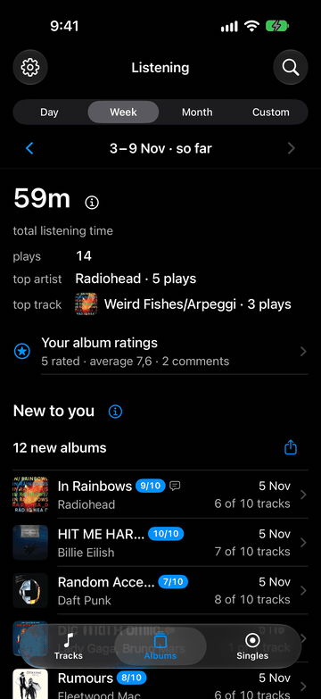
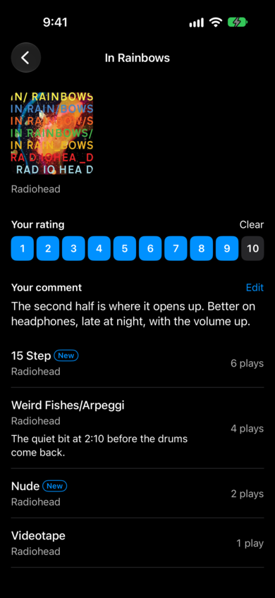
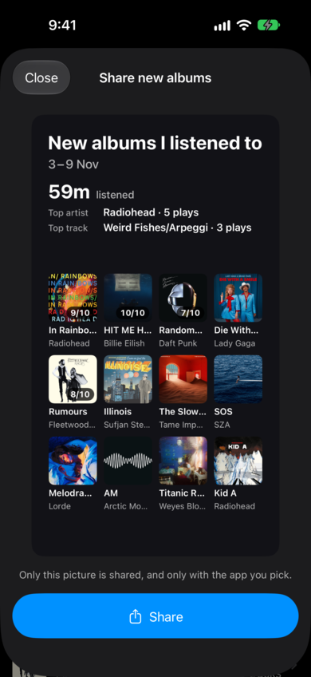
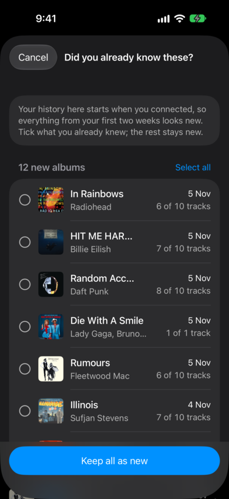
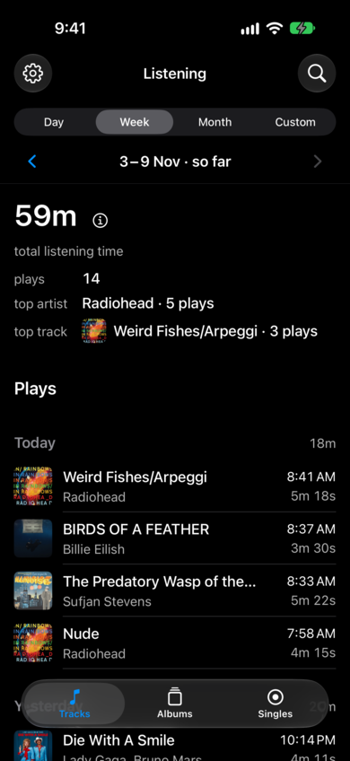
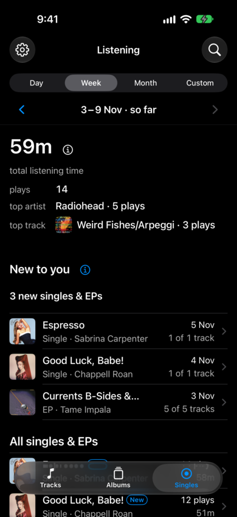
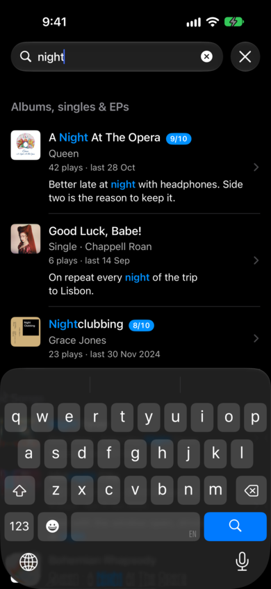

# new2u

**New to You** is an iPhone app with a small self-hosted server. It keeps your
Spotify listening history and shows you the music that is new to you: the
albums, singles and EPs you heard for the first time this week. You can rate
them, write notes, and share a picture of them.

> **Why this is open source.** I built this app for myself. Then I read that
> Spotify doesn't allow an app to use its API for more than 5 people unless it
> has at least 250,000 monthly active users. A small app like this can't get
> from one to the other, so I made it open source. You can run your own copy
> for yourself and up to four friends.

## Demo

<p align="center">
  
</p>

| New to you | Album: rating and notes | Share picture |
| :---: | :---: | :---: |
|  |  |  |
| **Did you already know these?** | **Listening** | **Singles & EPs** |
|  |  |  |
| **Search** | | |
|  | | |

<sub>The screenshots use the app's built-in demo data, not real listening
history. Album names and artwork belong to their owners and are shown only to
illustrate the app.</sub>

## Main features

- **New to you.** Albums, singles and EPs you played for the first time in the
  chosen day, week, month or custom range, with how many of their tracks you
  have heard so far. Music you already had (saved albums and songs, followed
  artists, top lists) doesn't count as new.
- **"Did you already know these?"** When you first connect, everything looks
  new. Tick what you already knew, or mark any album "Not new" later.
- **Listening summary.** Total listening time, plays, top artist and top track
  for any period, plus every play in order.
- **Ratings and notes.** Rate albums, singles and EPs from 1 to 10 and write a
  note on an album or on a single track. "Your album ratings" sorts them into
  leagues.
- **Share picture.** A picture of the period's new albums with your ratings,
  your top artist and your top track, ready to post.
- **Search** across albums, singles, songs and your own notes.
- **Your full history.** Spotify's API only remembers your last 50 plays, so
  the server checks Spotify every few minutes and keeps everything. You can
  also upload the extended streaming history file Spotify emails you
  (`my_spotify_data.zip`) to bring in years of plays.
- **Private by design.** Each server is yours. Spotify tokens are encrypted at
  rest, the logs never contain what you played, and the app hides its screen
  in the app switcher. You can download all your data as JSON or delete
  everything.

## How it works

```
iPhone app (SwiftUI)  ──https──▶  API (FastAPI)  ──▶  PostgreSQL
                                        ▲
                     poller ────────────┘──▶  Spotify Web API
```

- **`ios/`**: the SwiftUI app. You build it yourself, pointed at your server.
- **`src/app/`**: a Python 3.12 FastAPI server and a separate poller process.
  The poller collects your plays from Spotify.
- **`deploy/`, `scripts/`**: one-command setup for an Ubuntu server, Docker
  Compose with Caddy (automatic HTTPS), deploys and rollbacks, and nightly
  encrypted backups.

## Host it yourself

You need:

- a small Ubuntu 24.04 server with a public IP (any provider), and optionally
  a domain name;
- a Spotify account to own your Spotify developer app;
- a Mac with Xcode and an iPhone (iOS 17+). A free Apple ID works.

### 1. Create a Spotify app

1. Open the [Spotify developer dashboard](https://developer.spotify.com/dashboard)
   and create an app that uses the **Web API**.
2. Add the redirect URI `https://<your-server>/auth/spotify/callback`.
3. Copy the **Client ID**. The client secret is optional, because sign-in uses
   PKCE.
4. Under **User Management**, add every person who will use your server (up
   to 5).

### 2. Try it locally (optional)

```sh
git clone https://github.com/ABckh/spotify-new2u.git && cd spotify-new2u
cp .env.example .env    # fill in the Spotify client ID and the two keys it explains
docker compose up --build
docker compose run --rm api alembic upgrade head
curl -s http://127.0.0.1:8000/healthz    # {"status":"ok"}
```

For local use, register `http://127.0.0.1:8000/auth/spotify/callback` as the
redirect URI too. Spotify doesn't accept `localhost`.

### 3. Put it on a server

1. **Fork this repository.** Your fork's GitHub Actions build the server image
   and publish it to `ghcr.io/<you>/new2u`.
2. **Prepare the server** with one command run from your machine over SSH. It
   sets up the firewall, SSH hardening, Docker, a `deploy` user and the backup
   timer. The guide shows how to pin the server's host key and make the
   deploy key first:

   ```sh
   DEPLOY_HOST=SERVER_IP BOOTSTRAP_USER=ubuntu \
   DEPLOY_SSH_KEY_FILE=~/.ssh/id_ed25519 \
   DEPLOY_KNOWN_HOSTS="$(cat known_hosts.new2u)" \
   DEPLOY_PUBKEY="$(cat ~/.ssh/new2u-deploy.pub)" \
   scripts/bootstrap-remote.sh
   ```

3. **Deploy**, either from your machine with `scripts/deploy-remote.sh` or with
   the GitHub Actions deploy workflow. Caddy gets the HTTPS certificate on its
   own, even for a bare IP address.
4. **Allow your users.** Put their Spotify account IDs in
   `SPOTIFY_ALLOWED_ACCOUNT_IDS`. They must also be in the Spotify dashboard's
   User Management.

The full guide covers every input, backups, restore, rollback and moving
providers: **[docs/self-hosting.md](docs/self-hosting.md)**.

### 4. Install the iPhone app

```sh
cp ios/Signing.local.xcconfig.example ios/Signing.local.xcconfig   # add your Apple team ID
API_BASE_URL=https://<your-server> scripts/ios-install-device.sh
```

Set `APP_CALLBACK_URL=new2u://signed-in` on the server. With a free Apple ID,
run the script again every 7 days. Details:
**[docs/ios.md](docs/ios.md)**.

## Docs

- [Self-hosting](docs/self-hosting.md): the Spotify app, the server, deploys,
  backups and restore
- [The iPhone app](docs/ios.md): build it for your server
- [Configuration](docs/configuration.md): the settings that are easy to get
  wrong; `.env.example` lists them all
- [How it works](docs/how-it-works.md): sign-in, collection and the API
- [Development](docs/development.md): run it locally and run the checks
- [Contributing](CONTRIBUTING.md) and [Security](SECURITY.md)

## License

[MIT](LICENSE). New to You is not affiliated with or endorsed by Spotify.
Spotify is a trademark of Spotify AB.
